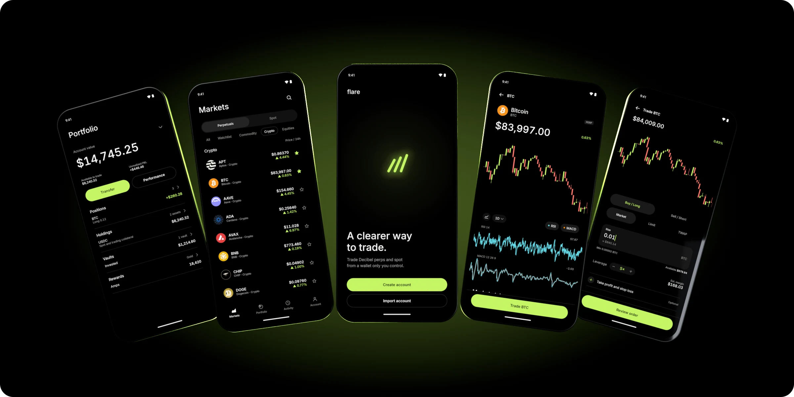

<p align="center">
  
</p>

<h1 align="center">Flare</h1>

<p align="center">
  <b>A clearer way to trade.</b><br>
  An open-source app for trading perps and spot on <a href="https://decibel.trade">Decibel</a> and <a href="https://hyperliquid.xyz">Hyperliquid</a>, on Android and iOS.<br>
  Use it just as it comes, or make it entirely your own.
</p>

<p align="center">
  <a href="https://github.com/emeieiron/flare/releases/latest">Download</a>
  &nbsp;·&nbsp;
  <a href="https://flare.mcxross.xyz">Website</a>
  &nbsp;·&nbsp;
  <a href="#build-it-yourself">Build it yourself</a>
</p>

> [!NOTE]
> Flare is under active development. Both apps trade real funds on mainnet: Decibel on **Aptos mainnet** and Hyperliquid on **Hyperliquid mainnet**. Start small and [share feedback](https://github.com/emeieiron/flare/issues).

## Contents

- [Made to be yours](#made-to-be-yours)
- [Features](#features)
- [Get Flare](#get-flare)
- [Tech stack](#tech-stack)
- [Architecture](#architecture)
- [Agent skills](#agent-skills)
- [Build it yourself](#build-it-yourself)
- [Security](#security)
- [Contributing & license](#contributing--license)

## Made to be yours

Flare is a complete app with thoughtful defaults, and a personal app waiting to happen. Every line is here to **inspect**, **fork** and **modify** until it fits the way you trade. Its architecture and design system double as a blueprint for Web3 mobile apps on any chain.

## Features

- **Markets**: Crypto, equities and commodities, in perps and spot, with live prices, a watchlist and search.
- **Charts**: Live candles or a clean line, RSI and MACD, and panning through history.
- **Strategies**: Independent MACD crossover, RSI reversal and momentum pullback signals, with optional Jev confluence, paper simulation and explicitly authorized real auto trading.
- **Orders**: Market, limit and TWAP, with leverage and attached take profit and stop loss.
- **Portfolio**: Account value, P&L, positions, holdings, DLP vaults, Amps rewards, transfers, deposits and withdrawals.
- **Self-custody**: Create a BIP-39 wallet or import a phrase, an Ed25519 or Secp256k1 key, or an AIP-80 key. Keys stay on the device behind biometrics or passcode. Trades sign with a delegated key that can't withdraw.
- **One-confirmation setup**: Flare opens your trading account and enables trading in a single step. An interrupted setup resumes where it left off.
- **Sponsored fees**: Flare's gas station pays network fees. If it can't, Flare asks before your wallet pays.
- **Offline resilience**: Transactions are simulated before approval, journaled before sending and reconciled on restart.

### Strategy signals

Open a market, choose its chart timeframe, then tap **Strategies** and **Evaluate signals**. The sheet shows closed-candle signals and indicator evidence; refresh when a result expires. Signals use independent market reads and do not place orders. To trade, return to the market's **Trade** button, enter an amount and review the order.

Strategies work without an API key. To add optional confluence, open **Settings → Jev confluence**, save your Jev API key and explicitly enable it. The key stays in the device's secure vault; indicator requests go directly to Jev. If Jev is unavailable, independent signals remain visible without model approval. Model confidence and choice probabilities describe the model's answer, not a trade's likelihood of success. Calendar-month timeframes are unavailable because these strategies require fixed candle intervals.

### Auto trading

From **Strategies → Auto trading**, pick **Simulation** or **Real** and a strategy, then set order size, maximum position, order-value budget, attempts, duration, cooldown, slippage, leverage and the minimum Jev confidence under **Run limits**. The run decides once per newly closed candle in the market’s chart timeframe, and never twice on the same candle. Simulation fills against the live order book at 1× leverage with a 5 bps fee, excluding funding, network fees and liquidation.

With Jev confluence on, Jev is asked only when the strategy proposes a trade; an unavailable or low-confidence answer vetoes that trade. **Real** needs a review of the account and limits and one authorization. Each attempt reserves its worst-case order value before it’s sent through the market’s order rules and the transaction journal; a pending or uncertain order stays counted and is never resent. An opposite signal first reduces the open position with a reduce-only order.

During a real run, **Confirm transactions** in Settings is off and locked. Its previous setting comes back when the run pauses or ends, when Flare leaves the foreground, or on the next launch if the app was closed mid-run. **Pause** stops new orders and leaves positions open; resuming keeps the run’s limits, counters and reservations. Duration counts from the first start. Use **Reset for a new run** to clear them before changing configuration. The order-value budget excludes fees and is not a loss cap.

## Get Flare

**Android:** each exchange is its own app. Download [`flare-decibel-android.apk`](https://github.com/emeieiron/flare/releases/latest/download/flare-decibel-android.apk) or [`flare-hyperliquid-android.apk`](https://github.com/emeieiron/flare/releases/latest/download/flare-hyperliquid-android.apk) from the [latest release](https://github.com/emeieiron/flare/releases/latest). The release notes explain how to verify the checksum, signing certificate and build provenance.

- **Decibel** runs on Aptos mainnet and trades real funds. Deposit USDC on Aptos and keep a little APT for the fees Flare's gas station cannot cover.
- **Hyperliquid** runs on Hyperliquid mainnet and trades real funds. Fund it by sending USDC to your address on Hyperliquid from another Hyperliquid account. USDC sent to the same address on Arbitrum does not reach Hyperliquid: the Arbitrum bridge credits the wallet that bridged, and deposits under 5 USDC are lost. Withdrawals go to Arbitrum for Hyperliquid's 1 USDC fee.
- **Already on the Hyperliquid testnet build?** The first mainnet launch clears the testnet trading state; your wallet carries over and setup runs again on mainnet.
- **Already testing Decibel?** The Decibel app now installs as `xyz.mcxross.flare.decibel`, so it can't upgrade an earlier Flare in place. Install it alongside, then restore your wallet from its recovery phrase or re-import your trading key. Your wallet carries over; the trading account does not, so setup runs again on mainnet.

**iOS:** [build it yourself](#build-it-yourself) for now. App Store and Google Play listings will follow.

## Tech stack

| Layer | Technology |
| :--- | :--- |
| **UI** | Compose Multiplatform, Vico charts, MVVM |
| **Platforms** | Android, iOS (SwiftUI shell hosting the shared UI) |
| **Blockchain** | [Kaptos](https://github.com/mcxross/kaptos) (Aptos), FastKrypto (Hyperliquid signing) |
| **State & DI** | Koin, Coroutines & Flow |
| **Storage** | Room, DataStore, Android Keystore, iOS Keychain |
| **Networking** | Ktor HTTP & WebSockets, Decibel Worker proxy |

## Architecture

```
flare/
├── androidApp/        # Android app: one product flavor per exchange
├── iosApp/            # SwiftUI shell: one scheme per exchange
├── ios-decibel/       # The iOS framework for the Decibel build
├── ios-hyperliquid/   # The iOS framework for the Hyperliquid build
├── venue-decibel/     # Decibel behind Flare's venue seam
├── venue-hyperliquid/ # Hyperliquid behind Flare's venue seam
├── shared/            # Screens, ViewModels, storage and the neutral venue interfaces
├── decibel/           # Headless Decibel protocol SDK
├── hyperliquid/       # Headless Hyperliquid protocol SDK
├── baselineprofile/   # Startup and journey baseline profiles
└── skills/            # Agent skills distilled from Flare
```

```
androidApp (decibel flavor)    iosApp ("Flare Decibel" scheme, via :ios-decibel)
              └───────────────┬───────────────┘
                        :venue-decibel  ───►  :shared
                              │
                          :decibel  ───►  Kaptos (Aptos)

androidApp (hyperliquid flavor)    iosApp ("Flare Hyperliquid" scheme, via :ios-hyperliquid)
              └─────────────────┬─────────────────┘
                        :venue-hyperliquid  ───►  :shared
                              │
                        :hyperliquid  ───►  FastKrypto (keys, signing)
```

Each build links one exchange. A `:venue-*` module implements `:shared`'s neutral interfaces with its exchange's SDK; `:shared` never depends on an exchange SDK.

## Agent skills

[`skills/`](skills) teaches coding agents to build Web3 mobile apps the way Flare is built, on any chain:

- **[`flare-architecture`](skills/flare-architecture/SKILL.md)**: structure, MVVM, chain SDKs, transaction safety, signing, onboarding.
- **[`flare-design-system`](skills/flare-design-system/SKILL.md)**: themes, custom components, signing screens, formatting, charts, motion.

## Build it yourself

**Prerequisites:** JDK 21+, Android SDK 37, Xcode 16+ (for iOS), and the companion [`decibel-worker`](https://github.com/emeieiron/decibel-worker).

```sh
# 1. Start the worker proxy
git clone https://github.com/emeieiron/decibel-worker
cd decibel-worker && npm ci && cp .dev.vars.example .dev.vars && npm run dev

# 2. Run Android against that local worker. Without -PflareWorkerUrl a build talks to the
#    deployed mainnet worker and trades real funds.
./gradlew :androidApp:installDecibelDebug -PflareWorkerUrl=http://10.0.2.2:8787
```

Each exchange is a product flavor: `assembleDecibelDebug` builds an APK, `assembleDecibelRelease` a release build. The Hyperliquid build (`installHyperliquidDebug`) needs no worker; it sets up a wallet, shows live markets and the account, and trades perps and spot (market, limit and TWAP orders, TP/SL, cancels, leverage) with an agent key on the device, for the wallet's account or a sub-account it already has. It withdraws to Arbitrum, sends USDC to other Hyperliquid accounts and between perps and spot, deposits into and redeems from vaults such as HLP, and shows the fee tier and referral standing. It trades Hyperliquid mainnet, and offers Flare's builder fee only when built with `-PflareHyperliquidBuilderAddress=0x…` (on iOS, `FLARE_HYPERLIQUID_BUILDER_ADDRESS` in `Hyperliquid.xcconfig`).

For iOS, open `iosApp/iosApp.xcodeproj` in Xcode and run the `Flare Decibel` or `Flare Hyperliquid` scheme.

## Security

Keys never leave the device's secure hardware and are excluded from backups. Node and gas credentials stay on a stateless worker proxy, never on devices. To report a vulnerability, see [SECURITY.md](SECURITY.md).

## Contributing & license

Contributions and feedback are welcome. See [CONTRIBUTING.md](CONTRIBUTING.md). Flare is licensed under [Apache 2.0](LICENSE).
