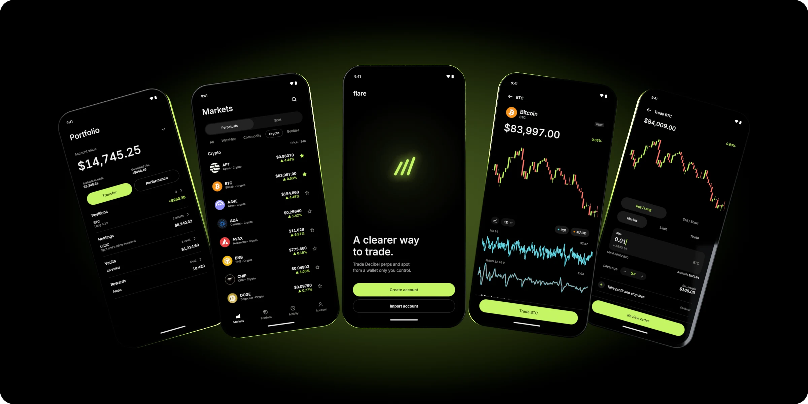

<p align="center">
  
</p>

<h1 align="center">Flare</h1>

Flare is an open-source foundation for building your own onchain mobile app
on Android and iOS.

Start with the included trading app, customize its interface and workflows,
or use its architecture and design system for a different application.

[Download](#current-integrations) · [Website](https://flare.mcxross.xyz) · [Build](#build)

## Make it your own

Flare brings together wallet management, market data, charts, order entry,
portfolio tracking and transaction handling. Its protocol SDKs are separate
from the UI, and exchange integrations implement shared application interfaces.

You can change the app's design, add strategies, integrate another trading
venue, or reuse individual modules. Additional protocols and chains require
their own integration and signing logic.

The repository includes guidance for developers and coding agents:

- [Architecture](skills/flare-architecture/SKILL.md): module boundaries,
  application state, wallet integration and transaction handling.
- [Design system](skills/flare-design-system/SKILL.md): themes, components,
  charts, financial formatting and interaction patterns.

Built with Kotlin Multiplatform and Compose Multiplatform.
See [DESIGN.md](DESIGN.md) for interface decisions and
[CONTRIBUTING.md](CONTRIBUTING.md) for development conventions.

## Included app

The trading app provides:

- Live markets, watchlists, search and charts with RSI and MACD.
- Market, limit and TWAP orders, leverage, take profit and stop loss.
- Portfolio balances, P&L, positions, vaults, rewards and transfers.
- Wallet creation and import, device authorization and delegated trading keys.
- Strategy signals, paper simulation and explicitly authorized real auto trading.

Features depend on the integration. Strategies run without an API key;
Jev confluence is optional. See the [strategy guide](docs/strategies.md)
for configuration, execution limits and simulation assumptions.

## Current integrations

Each integration has its own Android app and independent releases.
Each app build includes one trading venue.

| Integration | Android release | Network |
| --- | --- | --- |
| Decibel | [0.2.0, build 203](https://github.com/emeieiron/flare/releases/tag/decibel-v0.2.0) | Aptos mainnet |
| Hyperliquid | [v0.1.0 preview](https://github.com/emeieiron/flare/releases/tag/v0.1.0) | Testnet |

The published Hyperliquid APK is an older testnet preview.
Current source builds target Hyperliquid mainnet.

Flare is under active development. Mainnet builds trade real funds.
For Decibel, deposits use USDC on Aptos; keep APT available for fees
that sponsorship does not cover.

Release notes include download verification details.
See the [installation guide](docs/installation.md) for updates,
wallet migration and fee behavior.

For iOS, build from source.

## Build

Requires JDK 21+, Android SDK 37, and Xcode 16+ for iOS.

### Android

From the Flare repository:

```sh
./gradlew :androidApp:installDecibelDebug
# or
./gradlew :androidApp:installHyperliquidDebug
```

Both builds target mainnet. Decibel uses the deployed
[worker proxy](https://github.com/emeieiron/decibel-worker) by default;
Hyperliquid needs no worker.

To use a local Decibel worker, follow its setup instructions, then run
from the Flare repository:

```sh
./gradlew :androidApp:installDecibelDebug \
  -PflareWorkerUrl=http://10.0.2.2:8787
```

`10.0.2.2` reaches the development host from the Android emulator.
Using a local worker does not switch Decibel to testnet.

### iOS

Open `iosApp/iosApp.xcodeproj` in Xcode and run the
`Flare Decibel` or `Flare Hyperliquid` scheme.

See [CONTRIBUTING.md](CONTRIBUTING.md) for checks, dependency setup,
release builds and integration configuration.

## Security

Wallet secrets remain on the device, protected by Android Keystore
or iOS Keychain and excluded from backups. Delegated trading keys
cannot withdraw funds. Decibel node and gas credentials stay on the worker.

Follow the [security reporting guidance](CONTRIBUTING.md#security-reports)
for vulnerabilities.

## Contributing and license

See [CONTRIBUTING.md](CONTRIBUTING.md). Licensed under [Apache 2.0](LICENSE).
